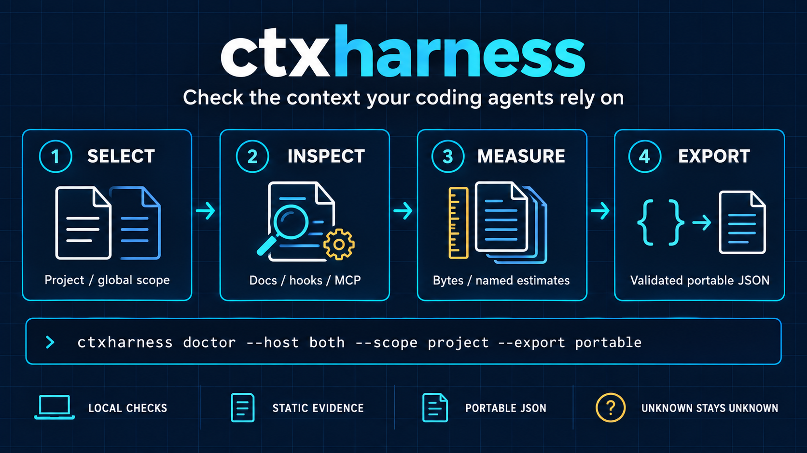

# ctxharness

<table>
  <tr>
    <td width="64">
      <a href="https://www.florian.bruniaux.com/about/?utm_source=github&amp;utm_medium=readme&amp;utm_campaign=ctxharness"></a>
    </td>
    <td>
      <strong><a href="https://www.florian.bruniaux.com/about/?utm_source=github&amp;utm_medium=readme&amp;utm_campaign=ctxharness">Florian BRUNIAUX</a></strong> &middot; AI Founding Engineer @ <a href="https://methode-aristote.fr/">Méthode Aristote</a><br />
      13 years from developer to CTO / VP Eng &middot; <a href="https://www.florian.bruniaux.com/blog/?utm_source=github&amp;utm_medium=readme&amp;utm_campaign=ctxharness">Blog &#8599;</a> &middot; <a href="https://www.florian.bruniaux.com/projects/?utm_source=github&amp;utm_medium=readme&amp;utm_campaign=ctxharness">Projects &#8599;</a>
    </td>
  </tr>
</table>

**Check the context your coding agents rely on.**

Catch stale paths, scripts and versions in your AI docs. Inspect Claude Code and Codex configuration, measure static source sizes and export validated evidence for other tools.

CTX Harness is a local CLI and TypeScript library. It reads your existing `CLAUDE.md`, `AGENTS.md` and `.cursorrules`, compares documented claims with your codebase and makes missing evidence explicit.

<p align="center">
  
</p>

<p align="center">
  <a href="#quick-start">Quick start</a> &middot;
  <a href="#what-it-checks">Capabilities</a> &middot;
  <a href="#configuration-doctor">Configuration doctor</a> &middot;
  <a href="#cli">CLI reference</a> &middot;
  <a href="#ci-integration">CI integration</a> &middot;
  <a href="#documentation">Documentation</a>
</p>

The diagram shows static diagnosis and export. Loading, trust, execution and runtime benefit need separate evidence. [Image description and generation notes](docs/assets/README.md).

## What it checks

| Need                               | What you get                                                                                      | Start with                                           |
| ---------------------------------- | ------------------------------------------------------------------------------------------------- | ---------------------------------------------------- |
| **Documentation drift (L1)**       | Paths, npm scripts, versions, counts and regex captures checked against local code.               | `scan`, `init`, `run`                                |
| **Static instruction checks (L2)** | Vague-language heuristics, instruction ratios and a named context-size estimate.                  | YAML assertions, `score`                             |
| **Configuration diagnosis (L3)**   | Supported instruction, skill, rule, agent, hook and MCP declarations for Claude Code and Codex.   | `doctor --host … --scope …`                          |
| **Coverage and source sizes**      | Declared applicability, unsupported surfaces, exact bytes and explicit estimates with provenance. | `doctor --coverage --budget`                         |
| **Reusable evidence**              | Validated, versioned portable JSON that omits raw paths, messages and credentials.                | `doctor --export portable`                           |
| **Optional extensions**            | Separate structural snapshots/diffs and caller-selected filesystem tool availability.             | `config-snapshot`, `config-diff`, `doctor --tools …` |

**Release source:** `v0.5.0` includes the audit/export foundations and both optional extensions. A Git tag does not publish the npm packages; an existing npm installation may still contain `0.4.6`. Check `ctxharness --version` and use the source workflow below for this implementation. [Delivery status](docs/roadmap.md).

## Quick start

### Find drift without a config file

Run from the project you want to check, with Node.js available:

```bash
npx ctxharness scan CLAUDE.md
```

`scan` discovers supported path, script and version claims. It exits 1 when it finds drift; `--exit-zero` makes drift warning-only.

### Keep documentation checks repeatable

```bash
npx ctxharness init              # generate .ctxharness.yml from existing docs
npx ctxharness run               # check configured assertions
npx ctxharness doctor            # documentation report with L1/L2/L3 breakdown
```

<details>
<summary>See an illustrative documentation-drift report</summary>

Synthetic example, not a measured project result:

```
AI Context Test — 5 assertions

fact                    expected       mentions  status
────────────────────────────────────────────────────────────────────────
auth-config-path        true                  1  ✗ 1 mismatch
typecheck-script        true                  1  ✗ 1 mismatch
node-version            22.14.0               1  ✓ 1/1 pass
no-vague-language       check                 2  ✓ 2/2 pass
instruction-balance     check                 2  ✓ 2/2 pass
────────────────────────────────────────────────────────────────────────

Mismatches
────────────────────────────────────────────────────────────────────────
auth-config-path        CLAUDE.md:18   true        false
typecheck-script        CLAUDE.md:34   true        false
────────────────────────────────────────────────────────────────────────
✗ 2 mismatch(es) — update the file(s) listed above
```

</details>

### Inspect current configuration and export evidence

Build the versioned source checkout to use the audit/export features. This installs dependencies in the checkout and compiles the CLI:

```bash
git clone --branch v0.5.0 https://github.com/FlorianBruniaux/ctxharness.git
cd ctxharness
pnpm install --frozen-lockfile --ignore-scripts
pnpm build

node packages/cli/dist/index.js doctor --root /path/to/project --host both --scope project --coverage --budget --format json
node packages/cli/dist/index.js doctor --root /path/to/project --host both --scope project --export portable
```

Replace `/path/to/project` with the directory to inspect. These examples select project configuration only. `--scope global` explicitly selects personal configuration; `--scope both` includes both scopes. No selected hook, skill, agent, MCP server or tool is executed by configuration diagnosis.

In the reference below, `ctxharness` denotes your installed CLI. If its version predates `0.5.0`, substitute `node /path/to/ctxharness/packages/cli/dist/index.js` from the source build. See [doctor modes, formats and exit codes](docs/doctor.md).

## Install

<details>
<summary>Install the package globally or as a project dependency</summary>

```bash
npm install -g ctxharness
# or, inside your project:
pnpm add -D ctxharness
pnpm exec ctxharness --help
```

The CLI uses Node.js even when checking a Python, Go or Rust project. The [source workflow](#inspect-current-configuration-and-export-evidence) gives access to the tagged `v0.5.0` implementation independently of npm publication.

</details>

<details>
<summary>Why keep explicit facts in CLAUDE.md or AGENTS.md?</summary>

Some instructions belong in documentation: architecture choices, team conventions and where to find code. When you choose to state a fact explicitly, CTX Harness can compare supported claims with their local sources. It does not decide which instructions belong in your context.

</details>

## Configuration

Configure repeatable documentation assertions in `.ctxharness.yml`. Configuration diagnosis via `doctor --host … --scope …` works without this file.

<details>
<summary>Starter YAML: paths, scripts, instruction checks and hooks</summary>

`.ctxharness.yml`, minimal starter (one assertion per layer):

```yaml
version: 1

files:
  include:
    - 'CLAUDE.md'
    - 'AGENTS.md'
    - '.cursorrules'
  exclude:
    - 'node_modules/**'

assertions:
  # L1 — fact drift: auth config path still exists
  - id: auth-config-path
    extractor: fileExists
    extractorArgs:
      path: src/modules/auth/config.ts
    scanner: literalInMd

  # L1 — fact drift: typecheck script matches package.json
  - id: typecheck-script
    extractor: packageScript
    extractorArgs:
      script: type-check
    scanner: literalInMd

  # L2 — instruction quality: no vague language
  - id: no-vague-language
    extractor: constant
    extractorArgs:
      value: check
    scanner: vaguenessPattern

  # L3 — context assembly: hooks are valid
  - id: hook-validity
    extractor: constant
    extractorArgs:
      value: check
    scanner: hookValidity
```

</details>

<details>
<summary>Advanced YAML: intentional mismatches and per-assertion file scope</summary>

```yaml
assertions:
  # allowlist: skip known-intentional mismatches in specific files
  - id: next-version
    extractor: packageJson
    extractorArgs:
      package: next
    scanner: inlineRegex
    scannerArgs:
      pattern: 'Next\.js\s+v?(\d+(?:\.\d+(?:\.\d+)?)?)'
    allowlist:
      - CHANGELOG.md # version history file — intentional old values

  # scopeFiles: restrict an assertion to a subset of files
  - id: instruction-balance
    extractor: constant
    extractorArgs:
      value: check
    scanner: negativeConstraintDensity
    scannerArgs:
      minRatio: 2.0
    scopeFiles:
      include:
        - 'CLAUDE.md'
        - 'AGENTS.md'
      exclude:
        - '.cursorrules' # constraint-only file by design
```

</details>

## Extractors

Read ground truth from your codebase. Common ones: `fileExists`, `packageScript`, `packageJson`, `nvmrc`, `gitStaleness`, `prismaModelList`, `goMod`, `cargoToml`.

<details>
<summary>Full extractor list (20)</summary>

| Name              | What it reads                                                                                                                       | Args                                                             |
| ----------------- | ----------------------------------------------------------------------------------------------------------------------------------- | ---------------------------------------------------------------- |
| `packageJson`     | `dependencies`/`devDependencies` version                                                                                            | `package: string`                                                |
| `packageManager`  | `packageManager` field (strips corepack hash)                                                                                       | None                                                             |
| `nvmrc`           | `.nvmrc` file                                                                                                                       | None                                                             |
| `fileExists`      | Whether a path exists (`"true"`/`"false"`)                                                                                          | `path: string`                                                   |
| `regexScan`       | Capture group from any file                                                                                                         | `path`, `pattern`, `group?`                                      |
| `countMatches`    | Count of pattern matches in a file                                                                                                  | `path`, `pattern`                                                |
| `constant`        | Fixed value (placeholder for quality scanners)                                                                                      | `value: string`                                                  |
| `prismaModel`     | Count of `model X {}` blocks in a Prisma schema                                                                                     | `path: string`                                                   |
| `prismaModelList` | JSON array of model names from a Prisma schema                                                                                      | `path: string`                                                   |
| `prismaEnum`      | Count of values in a named Prisma enum                                                                                              | `path: string`, `enum: string`                                   |
| `trpcRouter`      | Count of router entries in a tRPC root file                                                                                         | `path: string`                                                   |
| `trpcRouterList`  | JSON array of router names from a tRPC root file                                                                                    | `path: string`                                                   |
| `gitStaleness`    | Commits since a file was last changed (0 = up-to-date)                                                                              | `path: string`                                                   |
| `packageEngines`  | Node/runtime version from `package.json` `engines` field (strips `>=` operators)                                                    | `field?: string` (default `"node"`)                              |
| `tsconfigPaths`   | Count of path aliases in `tsconfig.json` `compilerOptions.paths` (JSONC-aware)                                                      | `path?: string` (default `"tsconfig.json"`)                      |
| `pyprojectToml`   | Version from `pyproject.toml`, Poetry and PEP 621 formats                                                                           | `package?: string`, `field?: string`                             |
| `requirementsTxt` | Package version from `requirements.txt`                                                                                             | `package: string`, `path?: string`                               |
| `cargoToml`       | Version from `Cargo.toml`, own version or dependency; supports Cargo workspaces (`[workspace.package]`, `[workspace.dependencies]`) | `package?: string`, `field?: string`                             |
| `goMod`           | Module version from `go.mod`                                                                                                        | `module: string`                                                 |
| `packageScript`   | Returns `"true"`/`"false"` if a named npm script exists in `package.json`                                                           | `script` (required), `file` (optional, default `"package.json"`) |

Version normalization: `v22` matches `22.14.0`, partial mentions are valid.

</details>

## Scanners

Find and validate content in your AI doc files. Common ones: `inlineRegex`, `literalInMd`, `vaguenessPattern`, `hookValidity`, `coverageRatio`, `freshnessScore`.

<details>
<summary>Full scanner list (15)</summary>

### Drift scanners (compare against extractor value)

| Name             | What it scans                        | Args                         |
| ---------------- | ------------------------------------ | ---------------------------- |
| `inlineRegex`    | All lines matching a regex           | `pattern`, `flags?`          |
| `codeBlockRegex` | Lines inside fenced code blocks only | `pattern`, `lang?`, `flags?` |
| `yamlField`      | YAML front matter or inline YAML     | `field` (dot-path)           |
| `jsonField`      | Inline JSON blocks                   | `field` (dot-path)           |
| `literalInMd`    | Literal string presence              | `literal`                    |
| `pathReference`  | File path reference                  | `path`                       |

### Quality scanners (no extractor value needed, use `constant`)

| Name                        | What it detects                                                                                                             | Args                                                                                                     |
| --------------------------- | --------------------------------------------------------------------------------------------------------------------------- | -------------------------------------------------------------------------------------------------------- |
| `vaguenessPattern`          | Vague instructions ("be careful", "as needed", "use your judgment"…)                                                        | `patterns?: string[]`                                                                                    |
| `negativeConstraintDensity` | Positive/negative instruction ratio below threshold                                                                         | `minRatio?: number` (default 1.0)                                                                        |
| `contextBudget`             | File token footprint, fails if estimated tokens exceed threshold                                                            | `maxTokens?: number` (default 3000), `followImports?: boolean` (follows `@file.md` chains up to depth 3) |
| `ruleGlobValidity`          | Claude Code rules file, checks for YAML frontmatter and optional `paths:` field                                             | `requirePaths?: boolean` (default false)                                                                 |
| `hookValidity`              | **Standalone.** Resolves `.claude/settings.json` from project root and validates each hook entry                            | None                                                                                                     |
| `backtickEntityPresence`    | Checks that `` `entity` `` appears as inline code in the doc                                                                | `entity: string`                                                                                         |
| `skillValidity`             | **Standalone.** Globs `.claude/skills/**/*.md` from project root, validates YAML frontmatter has `name:` and `description:` | `requireDescription?: boolean` (default `true`)                                                          |
| `freshnessScore`            | **Standalone.** Interprets commit count from `gitStaleness`, returns pass/warn/fail based on thresholds                     | `warnAfter?: number` (default 30), `failAfter?: number` (default 100)                                    |
| `coverageRatio`             | Checks what fraction of a JSON array (from `prismaModelList`/`trpcRouterList`) appears in the doc                           | `minRatio?: number` (default 0.8), `valueAllowlist?: string[]`                                           |

**Standalone scanners** (`hookValidity`, `skillValidity`, `freshnessScore`) bypass `files.include` and resolve their own targets from the project root. You do not add their paths to `files.include`, they run once regardless of how many files are in scope.

`vaguenessPattern` accepts custom patterns via `scannerArgs.patterns` (array of regex strings).

`contextBudget` estimates tokens as `chars ÷ 4`. Designed to run over `.claude/rules/**/*.md` or `CLAUDE.md` to catch bloated always-on context files. With `followImports: true`, it resolves `@file.md` references recursively up to depth 3 and includes their token footprint in the total.

`ruleGlobValidity` is designed to run over `.claude/rules/**/*.md`. By default it fails if a rules file has no YAML frontmatter (meaning it loads at every session with no scoping). Set `requirePaths: true` to also fail if the frontmatter lacks a `paths:` field.

`freshnessScore` works with `gitStaleness` extractor. `gitStaleness` returns the commit count since the file was last changed; `freshnessScore` compares it to your thresholds:

```yaml
- id: claude-md-freshness
  extractor: gitStaleness
  extractorArgs:
    path: CLAUDE.md
  scanner: freshnessScore
  scannerArgs:
    warnAfter: 20 # ⚠ warn if >20 commits since last edit
    failAfter: 50 # ✗ fail if >50 commits
```

`coverageRatio` checks that a fraction of your actual entities (models, routers…) are mentioned in the docs, useful when you can't document everything but want to enforce a minimum:

```yaml
- id: prisma-model-coverage
  extractor: prismaModelList
  extractorArgs:
    path: src/server/db/prisma/schema.prisma
  scanner: coverageRatio
  scannerArgs:
    minRatio: 0.5 # at least 50% of models mentioned
  valueAllowlist:
    - MigrationVersion # internal model, not required in CLAUDE.md
```

</details>

## CLI

```bash
ctxharness run       # run all assertions, exit 1 on drift
ctxharness check     # alias for run --format text
ctxharness scan      # scan a markdown file for verifiable claims without a config file
ctxharness score     # run assertions and report a 0-100 health score with grade (S/A/B/C/D/F)
ctxharness trend     # show cross-run drift score history — sparkline, direction, per-run table
ctxharness populate  # scan declared files and suggest new assertions for uncovered claims
ctxharness snapshot  # save a quality snapshot to .ctxharness/snapshots/
ctxharness diff      # compare against latest snapshot — exit 1 on score regression
ctxharness fix       # auto-fix version drift — dry-run by default, --apply writes files
ctxharness doctor    # comprehensive health check with L1/L2/L3 breakdown and remediation advice
ctxharness init      # scaffold .ctxharness.yml
```

`ctxharness init --hooks` also installs Husky post-merge / post-checkout hook scripts alongside the config.

Options:

```
-c, --config <path>    Config file path (default: .ctxharness.yml)
-f, --format <fmt>     Output format: text | json | gha (default: text)
-r, --root <dir>       Project root (default: cwd)
-w, --watch            Re-run on file changes (run command only)
```

These common options are command-specific. The configuration doctor uses `--format human|json|gha`, while `run` uses `--format text|json|gha`. Selecting `--host`, `--scope`, `--format`, `--runtime-evidence`, `--coverage`, `--budget`, `--export` or any tool option switches `doctor` to configuration mode; bare `doctor` retains its YAML assertion workflow. Use `ctxharness <command> --help` for the exact options.

### Configuration doctor

```bash
ctxharness doctor --host both --scope project --format human
ctxharness doctor --host claude --scope project --format json > doctor.local.json
ctxharness doctor --host codex --scope project --format gha
```

This mode does not require `.ctxharness.yml` and does not run hooks, skills, MCP servers or host clients. It reports `PASS`, `WARN`, `FAIL`, `UNKNOWN` and `N/A`; missing evidence stays unknown. Exit status is 1 for mandatory static failures or command errors and 0 otherwise. Exit 0 can therefore include warnings and unknowns.

<details>
<summary>Export portable JSON, declared coverage and static sizes</summary>

Local JSON includes source paths and diagnostic details. Review it before sharing. Use the versioned portable profile to omit paths, names, raw messages and credentials. It includes declared coverage and static sizes by default:

```bash
ctxharness doctor --host both --scope project --export portable > doctor.portable.json
ctxharness doctor --host claude --scope project --coverage --budget --format json
```

Byte counts measure discovered source content; the named character estimate does not establish model input or savings. Validate artifacts with the [core contracts and fixtures](docs/contracts/README.md). Opaque references do not guarantee anonymization.

</details>

<details>
<summary>Compare configuration snapshots without updating a baseline</summary>

```bash
ctxharness config-snapshot --host claude --scope project --output first.json
ctxharness config-snapshot --host claude --scope project --output second.json
ctxharness config-diff first.json second.json
```

Snapshot output never overwrites an existing file; structural comparison does not update the baseline or measure performance. These are separate from the documentation `snapshot` and `diff` commands. See the [full guide](docs/doctor.md#optional-configuration-snapshots).

</details>

<details>
<summary>Check explicitly selected tools in a declared client environment</summary>

```bash
ctxharness doctor --host claude --scope project --tools rg,gh --tool-path /opt/example/bin --tool-environment declared-client --format json
```

The example PATH is caller-supplied. Absent environment evidence stays unknown, and no tool is executed or installed. Authentication and client permissions remain unknown even when an executable is found. See [tool options and limits](docs/doctor.md#optional-tool-availability).

</details>

<details>
<summary>Preview and apply documentation-version fixes</summary>

`ctxharness fix` finds every assertion where the actual version differs from expected on a specific line and shows what it would change. Pass `--apply` to write the files:

```
$ ctxharness fix
CLAUDE.md:13  prisma-version  7.5 → 7.7.0
CLAUDE.md:42  next-version    15.2.0 → 15.3.1

Run ctxharness fix --apply to write changes.
```

</details>

### Zero-config scan

Scan a Markdown instruction file for supported claims before setting up `.ctxharness.yml`:

```bash
npx ctxharness scan CLAUDE.md
```

<details>
<summary>Read scan output, import traversal, config suggestions and hook behavior</summary>

This detects file paths, npm scripts, and version numbers mentioned in the file and checks each against your codebase. Paths and scripts first, because those are the claims most likely to silently break agent behavior when they drift.

```
Scanning CLAUDE.md...

  src/config/auth     fileExists   ✗ path not found (moved to src/modules/auth/config.ts?)
  npm run typecheck   packageScript  ✗ script not found in package.json
  Node.js 22.14.0    version      ✓ matches .nvmrc

2 issues found. Run with --suggest-config to generate .ctxharness.yml.
```

`scan` follows supported local `@file.md` imports up to depth 3 within caller-selected roots. Physical files are deduplicated, with provenance edges retained. Unsupported, missing, out-of-boundary or capped reads remain incomplete. See [read boundaries](docs/configuration-audit.md#selected-filesystem-reads).

```bash
npx ctxharness scan CLAUDE.md --suggest-config   # generate a starter .ctxharness.yml
npx ctxharness scan CLAUDE.md --exit-zero        # warn without blocking (hooks / CI)
```

The detector filters out common false positives: Claude Code slash commands (`/plan`, `/ship`), URL route patterns (`/api/chunk`, `/about/`), and template placeholders (`{slug}`, `[owner]`).

**scan vs run:** `scan` discovers claims without configuration and exits 1 when drift is found; `--exit-zero` makes drift warning-only. `run` enforces the assertions in `.ctxharness.yml` and exits 1 on failure. Input errors remain errors in either mode.

**Husky hook**, the `post-merge` template automatically picks the right mode:

```bash
# .husky/post-merge (generated by ctxharness init --hooks)
if [ -f ".ctxharness.yml" ]; then
  ctxharness check          # blocking — full enforcement
else
  ctxharness scan --exit-zero  # informational — zero-config discovery
fi
```

</details>

### Snapshot workflow

Save documentation-score baselines and flag score regressions in CI. These scores do not measure agent task quality.

<details>
<summary>Save and compare documentation-score snapshots</summary>

```bash
# Save baseline after initial setup
ctxharness snapshot

# In CI: compare against the committed baseline
ctxharness diff     # exit 1 if score dropped
```

Snapshots are saved to `.ctxharness/snapshots/` with timestamp. Commit the latest snapshot file to use `diff` in CI.

</details>

### Trend history

<details>
<summary>Read historical documentation scores and control history recording</summary>

`run`, `check`, `score`, and the YAML assertion mode of `doctor` auto-record a drift score to `~/.ctxharness/history.jsonl`. The configuration doctor does not record a trend entry. The `trend` command shows your documentation score history:

```bash
ctxharness trend

Trend — myproject (8 runs)

  Sparkline   ▃▅▆▇▇▇██
  Direction   ↑ improving  (+14 pts over 8 runs)
  Avg Score   91/100

  Date                    Score      G      Pass   Fail   Time
  ──────────────────────────────────────────────────────────────
  May 06, 14:23:01       100/100    S      5      0      42ms
  May 06, 11:45:22        98/100    S      5      0      38ms
  May 05, 09:12:08        87/100    B      4      1      55ms
  ...
```

Direction is computed by comparing the average of the first third of runs against the last third: `improving` (delta > 3 pts), `worsening` (delta < -3 pts), or `flat`.

```bash
ctxharness trend --all          # all projects
ctxharness trend --limit 50     # last 50 runs (default: 20)
ctxharness trend --project api  # specific project name
```

In CI, use `--no-trend` to skip recording, useful when you only want trend data from your main branch, not every PR run:

```bash
ctxharness run --no-trend
```

</details>

### populate

Scan your already-declared files for verifiable claims (semver, paths, scripts) and suggest assertions for any claims not yet in your config.

<details>
<summary>Preview new assertions or append them explicitly</summary>

```bash
# Dry-run (default): preview what would be added
ctxharness populate

# Write changes to .ctxharness.yml
ctxharness populate --apply
```

Typical workflow: run `ctxharness init` once to bootstrap the config, then run `ctxharness populate --apply` any time you update your AI docs and want to capture new claims.

</details>

### warn status

<details>
<summary>Interpret documentation warnings and the layered doctor report</summary>

Assertions can return three states: `pass`, `warn`, or `fail`. `warn` is counted as 0.5 in the score, useful for staleness checks where you want early signal without blocking CI:

```
⚠ 1 warn   — claude-md-freshness: 35 commits since last edit
```

`ctxharness doctor` categorizes all issues by layer, shows a per-layer score, and suggests next actions:

```
ctxharness doctor

L1  Doc Drift           ██████████  100/100
L2  Instruction Quality ████████░░   80/100
L3  Context Assembly    ██████░░░░   60/100

Score: 80/100  Grade: B

Issues:
  L2  no-vague-language   AGENTS.md:14   vague pattern found: "be careful"
  L3  hook-validity        .claude/settings.json   hook entry has empty matcher
```

</details>

## Plugin API

Extend the TypeScript core with custom extractors and scanners.

<details>
<summary>Register a plugin and reference it in YAML</summary>

```typescript
import { definePlugin, loadPlugin } from '@florianbruniaux/ctxharness-core'

const myPlugin = definePlugin({
  extractors: [
    {
      name: 'myExtractor',
      fn: (root, args) => {
        // read ground truth from codebase, return a string
        return '1.2.3'
      },
    },
  ],
  scanners: [
    {
      name: 'myScanner',
      fn: (filePath, expectedValue, args) => {
        // check the file, return ScanResult[]
        return [{ status: 'pass', line: 0, actual: expectedValue }]
      },
    },
  ],
})

loadPlugin(myPlugin)
```

Use `extractor: myExtractor` and `scanner: myScanner` in your `.ctxharness.yml` like any built-in.

</details>

## Stack presets

Start from a template for T3, Next.js App Router, Python, Go or Rust.

<details>
<summary>Choose and copy a preset from the source checkout</summary>

| Preset                       | Path                                    | Covers                                                                |
| ---------------------------- | --------------------------------------- | --------------------------------------------------------------------- |
| T3 (Next.js + Prisma + tRPC) | `templates/presets/t3.yml`              | node, next, typescript, prisma, trpc versions + model/router counts   |
| Next.js App Router           | `templates/presets/next-app-router.yml` | node, next, typescript, react versions + quality assertions           |
| Python                       | `templates/presets/python.yml`          | python version, pyproject.toml deps + quality assertions              |
| Go                           | `templates/presets/go.yml`              | go toolchain version, go.mod deps + quality assertions                |
| Rust                         | `templates/presets/rust.yml`            | crate version, Cargo.toml deps + quality assertions (workspace-aware) |

From a source checkout, copy a preset into the project you want to check:

```bash
cp templates/presets/t3.yml /path/to/project/.ctxharness.yml
```

</details>

## CI integration

GitHub Actions:

```yaml
- name: Check AI doc drift
  uses: FlorianBruniaux/ctxharness@v0.5.0
  with:
    config: .ctxharness.yml
    format: gha
```

Or copy `templates/ci/github-actions.yml` for a full workflow. GitLab CI and CircleCI templates are at `templates/ci/gitlab-ci.yml` and `templates/ci/circleci.yml`.

Husky (post-merge, post-checkout): copy from `templates/husky/`.

<details>
<summary>Keep shared Claude settings separate from machine-local overrides</summary>

### `.claude/settings.json` vs `settings.local.json`

Claude Code follows a two-file convention for project settings:

- **`settings.json`**, committed to the repo. Contains config that should work for anyone who clones the project: hook definitions, permission rules, shared assertions. Use relative paths for hook commands (`.claude/hooks/my-hook.sh`, not `/Users/yourname/...`).
- **`settings.local.json`**, gitignored. Contains machine-specific or personal overrides: your own keybindings, local path overrides, personal MCP servers.

`hookValidity` validates `settings.json`. If a hook command contains an absolute path (e.g. `/Users/yourname/...`), it returns `status: warn`, those paths break for every other contributor.

The same layering applies to `CLAUDE.md` files: project-level goes in the repo root (committed), personal goes in `~/.claude/CLAUDE.md` (your machine only). [Claude Code memory docs](https://docs.anthropic.com/en/docs/claude-code/memory).

</details>

## Documentation

| Guide                                                        | What to read it for                                                 |
| ------------------------------------------------------------ | ------------------------------------------------------------------- |
| [Documentation index](docs/README.md)                        | Current guides and historical design notes.                         |
| [Configuration doctor](docs/doctor.md)                       | Modes, selection, formats, exit codes and extension options.        |
| [Configuration audit](docs/configuration-audit.md)           | Read boundaries, supported checks, coverage and static-size limits. |
| [Versioned contracts and fixtures](docs/contracts/README.md) | Core APIs, portable validation and snapshot interoperability.       |
| [Delivery roadmap](docs/roadmap.md)                          | Integrated issues, dependency order and product scope.              |
| [Changelog](CHANGELOG.md)                                    | Unreleased changes and release history.                             |
| [Contributor instructions](CLAUDE.md)                        | Repository structure, checks and implementation rules.              |

## Product boundary

CTX Harness compares documented claims with local sources and diagnoses supported configuration declarations. It can check inputs produced by configuration generators or distribution tools without applying their output.

Session collectors, semantic optimization, task-quality judges, controlled cost/cache experiments and candidate application are outside this project. Importing a runtime result only records a caller declaration; it does not run or authenticate that result. The [delivery roadmap](docs/roadmap.md) keeps these responsibilities separate.

Declaration, supported applicability, observation and estimation remain distinct. A static score, smaller source file or structurally valid configuration does not establish what a model received, task success, saved tokens or latency. Missing evidence stays unknown. Portable references and digests do not guarantee anonymization.

## Further Reading

<details>
<summary>Background on context engineering, documentation drift and instruction files</summary>

**Context engineering, why accuracy matters**

- [Context Engineering](https://simonwillison.net/2025/Jun/27/context-engineering/), Simon Willison, June 2025. Why "context engineering" is a better term than "prompt engineering" and what it means in practice.
- [The Rise of Context Engineering](https://www.langchain.com/blog/the-rise-of-context-engineering), LangChain, June 2025. _"Most of the time when an agent is not performing reliably, the underlying cause is that the appropriate context has not been communicated to the model."_
- [Context Engineering for Large Codebases](https://packmind.com/context-engineering-ai-coding/context-engineering-large-codebases/), Packmind, April 2026. Documents "context drift", stale instruction files referencing deprecated frameworks cause agents to silently generate code using wrong patterns.

**What stale context does to LLMs**

- [Contextual Drag: How Errors in the Context Affect LLM Reasoning](https://arxiv.org/abs/2602.04288), arXiv, Feb 2026. Wrong context causes 10-20% performance drops across 11 models and 8 reasoning tasks. Self-refinement makes it worse, not better.
- [Knowledge Conflicts for LLMs: A Survey](https://arxiv.org/abs/2403.08319), EMNLP 2024. Temporal knowledge conflicts (outdated context vs. model knowledge) are a primary source of factually wrong outputs. LLMs may generate code using deprecated function signatures from older library versions.
- [Lost in the Middle](https://arxiv.org/abs/2307.03172), Stanford / ACL 2024. Relevant information placed in the middle of long contexts is systematically under-weighted by LLMs. Instruction files that accumulate stale content push critical facts into this dead zone.
- [Your Agent's Context Is a Junk Drawer](https://www.augmentcode.com/blog/your-agents-context-is-a-junk-drawer), Augment Code, Feb 2026. Documents "context collapse", agents forget earlier constraints when context grows stale and unmanaged.

**The CLAUDE.md / AGENTS.md problem specifically**

- [Writing a Good CLAUDE.md](https://www.humanlayer.dev/blog/writing-a-good-claude-md), HumanLayer, Nov 2025. `"Don't include code snippets — they will become out-of-date quickly."` Direct practitioner warning on content drift.
- [New Research Reassesses the Value of AGENTS.md Files](https://www.infoq.com/news/2026/03/agents-context-file-value-review/), InfoQ, March 2026. ETH Zurich study: LLM-generated context files reduce task success by 3% on average and increase inference costs by 20%+. Authors recommend limiting instructions to non-inferable details, exactly the facts ctxharness verifies.
- [When AGENTS.md Backfires](https://notchrisgroves.com/when-agents-md-backfires/), Feb 2026. Only 14.5% of agent context files include security instructions. LLM-generated files reduced task success in 5 of 8 evaluation settings.

</details>

<!-- BEGIN GENERATED RELATED PROJECTS -->
<!-- Source: https://github.com/FlorianBruniaux/FlorianBruniaux/blob/main/ecosystem/projects.json; project: ctxharness -->
## Explore the ecosystem

These projects extend the workflow without duplicating this tool:

- **Learn with [Claude Code Ultimate Guide](https://github.com/FlorianBruniaux/claude-code-ultimate-guide)**: connect the checks to the guide's context-engineering and harness practices.
- **Use with [claude-code-plugins](https://github.com/FlorianBruniaux/claude-code-plugins)**: validate contexts and rules installed through the plugin collection.
- **Secure with [agentsec-triage](https://github.com/FlorianBruniaux/agentsec-triage)**: combine documentation integrity with checks for documented campaigns and risky configuration.

[Browse the complete open-source galaxy](https://github.com/FlorianBruniaux#open-source-galaxy)
<!-- END GENERATED RELATED PROJECTS -->

## License

[MIT](LICENSE)
